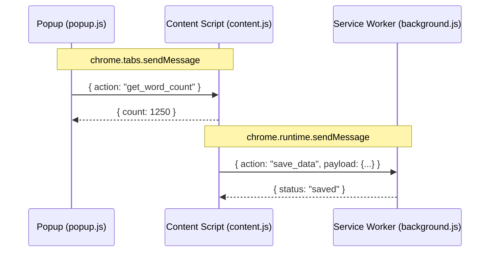

# 🏗️ Module 1: Chrome Extension Architecture & Lifecycle (Manifest V3)

> Manifest V3 के अंतर्गत Chrome Extension के आंतरिक तंत्र, कंपोनेंट कम्युनिकेशन और लाइफसाइकिल की संपूर्ण समझ।

---

## 1. मुख्य घटक (Core Components)

1. **`manifest.json`**:
   - एक्सटेंशन का रूट कॉन्फ़िगरेशन।
   - नाम, वर्ज़न, परमिशन, बैकग्राउंड वर्कर, कंटेंट स्क्रिप्ट और पॉपअप UI को परिभाषित करता है।

2. **Popup UI (`popup.html`, `popup.css`, `popup.js`)**:
   - टूलबार आइकॉन पर क्लिक करने पर खुलने वाला मिनी-वेबपेज।
   - यूज़र द्वारा बंद करते ही यह अनलोड (Destroy) हो जाता है।

3. **Content Script (`content.js`)**:
   - सीधे एक्टिव वेबपेज के अंदर (DOM में) चलता है।
   - पेज के HTML को पढ़ सकता है, बटन जोड़ सकता है, स्टाइल बदल सकता है।
   - यह आइसोलेटेड वर्ल्ड (Isolated World) में चलता है, यानी पेज की अपनी JS वैरिएबल्स के साथ इसका टकराव नहीं होता।

4. **Background Service Worker (`background.js`)**:
   - इवेंट-आधारित लाइफसाइकिल: ज़रूरत पड़ने पर वेक-अप होता है और आइडल होने पर सस्पेंड हो जाता है।
   - पूरे ब्राउज़र लेवल पर टैब्स, अलार्म, कुकीज़ और वेब रिक्वेस्ट को हैंडल करता है।

---

## 2. कंपोनेंट कम्युनिकेशन (Message Passing)



### (A) Popup से Content Script को संदेश भेजना:
```javascript
const [tab] = await chrome.tabs.query({ active: true, currentWindow: true });
chrome.tabs.sendMessage(tab.id, { action: "trigger_action" }, (response) => {
  console.log("Response:", response);
});
```

### (B) Content Script में संदेश सुनना (Listener):
```javascript
chrome.runtime.onMessage.addListener((request, sender, sendResponse) => {
  if (request.action === "trigger_action") {
    sendResponse({ status: "success" });
  }
  return true; // async response के लिए अनिवार्य
});
```
