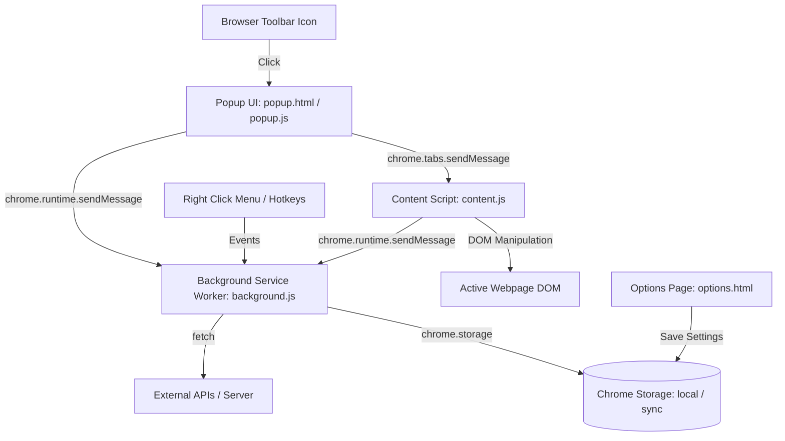

# 🚀 Chrome Extension (Manifest V3) — संपूर्ण मास्टर गाइड व नोट्स
> **कंप्लीट हैंडबुक**: बेसिक आर्किटेक्चर, स्टेप-बाय-स्टेप वर्किंग कोड, एडवांस्ड कंपोनेंट्स, $5 फ़ीस व पब्लिशिंग नियम, मॉनेटाइज़ेशन (कमाई), डीबगिंग, सुरक्षा नीतियां और AI प्रॉम्प्ट्स।

---

## 📑 विषय-सूची (Table of Contents)

1. [Chrome Extension क्या है और Manifest V3 के मूल नियम](#1-chrome-extension-क्या-है-और-manifest-v3-के-मूल-नियम)
2. [कोर आर्किटेक्चर (Core Architecture Breakdown)](#2-कोर-आर्किटेक्चर-core-architecture-breakdown)
3. [प्रैक्टिकल वर्किंग प्रोजेक्ट: Smart Styler & Word Counter](#3-प्रैक्टिकल-वर्किंग-प्रोजेक्ट-smart-styler--word-counter)
   - `manifest.json`
   - `popup.html`, `popup.css`, `popup.js`
   - `content.js`
4. [ब्राउज़र में टेस्ट और रन करने की विधि (Developer Mode)](#4-ब्राउज़र-में-टेस्ट-और-रन-करने-की-विधि-developer-mode)
5. [एडवांस्ड कंपोनेंट्स और कोड (Advanced Components & Code)](#5-एडवांस्ड-कंपोनेंट्स-और-कोड-advanced-components--code)
   - Background Service Worker & Right-Click Context Menu
   - Options / Settings Page & Storage API (`local` vs `sync`)
   - Keyboard Shortcuts (Hotkeys)
   - External APIs, CORS और `host_permissions`
6. [सामान्य Errors और 100% सटीक समाधान (Troubleshooting Guide)](#6-सामान्य-errors-और-100-सटीक-समाधान-troubleshooting-guide)
7. [Chrome Web Store पब्लिशिंग और $5 फ़ीस के सभी नियम](#7-chrome-web-store-पब्लिशिंग-और-5-फ़ीस-के-सभी-नियम)
   - $5 One-Time Fee की सच्चाई
   - 20 Extensions की लिमिट और समाधान
   - अनलिमिटेड फ्री अपडेट्स
   - बिना $5 दिए फ्री में पब्लिश करने के 3 विकल्प (Edge, Firefox, GitHub)
   - पब्लिशिंग के 3 प्रकार (Public, Unlisted, Private)
   - सबमिशन चेकलिस्ट और रिव्यू टाइम
8. [कमाई (Monetization) के सभी तरीके और फ़ायदे](#8-कमाई-monetization-के-सभी-तरीके-और-फ़ायदे)
   - Freemium / Monthly Subscription (SaaS)
   - Lifetime Deals (LTD)
   - Affiliate Marketing
   - Micro-SaaS Exit (एक्सटेंशन बेचना)
   - करियर और पोर्टफोलियो के गैर-वित्तीय फ़ायदे
9. [Google की सख्त नीतियां और सुरक्षा नियम (Critical Guidelines)](#9-google-की-सख्त-नीतियां-और-सुरक्षा-नियम-critical-guidelines)
   - Remote Code Ban (रिमोट कोड पर प्रतिबंध)
   - Trademark और नामकरण नियम
   - Single Purpose Policy (एकल उद्देश्य नीति)
   - अकाउंट लिंकिंग और सुरक्षा चेतावनी
10. [आधुनिक टूल्स और फ्रेमवर्क्स (Modern Stacks: WXT / Plasmo)](#10-आधुनिक-टूल्स-और-फ्रेमवर्क्स-modern-stacks-wxt--plasmo)
11. [AI मास्टर प्रॉम्प्ट्स (Master Prompts for AI)](#11-ai-मास्टर-प्रॉम्प्ट्स-master-prompts-for-ai)

---

## 1. Chrome Extension क्या है और Manifest V3 के मूल नियम

एक Chrome Extension मूल रूप से **HTML, CSS और JavaScript** का एक पैकेज होता है जो ब्राउज़र के फ़ीचर्स और वेबपेजों के साथ इंटरैक्ट करता है।

वर्तमान में Google केवल **Manifest V3** का समर्थन करता है, जिसके 3 सुनहरे नियम हैं:
1. **No Inline JavaScript**: HTML में `onclick="..."` या `<script>code</script>` पूरी तरह प्रतिबंधित है (Content Security Policy - CSP)।
2. **No Remote Code**: किसी बाहरी CDN (जैसे `jsdelivr`, `unpkg`, `cdnjs`) से लाइव JS लोड नहीं कर सकते। सभी कोड लोकल ZIP में होने चाहिए।
3. **Background Service Worker**: पुराने Manifest V2 के बैकग्राउंड पेज (जो हमेशा रैम में चलते रहते थे) हटा दिए गए हैं। अब इवेंट-आधारित Service Worker का उपयोग होता है जो ज़रूरत पड़ने पर शुरू होता है और फिर सो (idle/suspend) जाता है।

---

## 2. कोर आर्किटेक्चर (Core Architecture Breakdown)



- **`manifest.json`**: एक्सटेंशन का पहचान पत्र और कॉन्फ़िगरेशन।
- **Popup UI**: टूलबार आइकॉन पर क्लिक करने पर दिखने वाला छोटा मेन्यू।
- **Content Script**: वेबपेज के अंदर इंजेक्ट होकर पेज के HTML/CSS (DOM) को पढ़ने और बदलने वाला कोड।
- **Background Service Worker**: पूरे ब्राउज़र के बैकग्राउंड इवेंट्स (टैब चेंज, हॉटकीज़, अलार्म, नेटवर्किंग) को हैंडल करने वाला इंजन।
- **Storage**: एक्सटेंशन का अपना डेटाबेस (`chrome.storage.local` / `chrome.storage.sync`)।

---

## 3. प्रैक्टिकल वर्किंग प्रोजेक्ट: Smart Styler & Word Counter

यह एक्सटेंशन एक्टिव वेबपेज के शब्दों को गिनता है और एक क्लिक में रीडिंग मोड लागू करता है।

### फ़ोल्डर स्ट्रक्चर:
```text
my-smart-extension/
├── manifest.json
├── popup.html
├── popup.css
├── popup.js
├── content.js
├── background.js
├── options.html
├── options.js
└── icons/
    ├── icon16.png
    ├── icon48.png
    └── icon128.png
```

### 1. `manifest.json`
```json
{
  "manifest_version": 3,
  "name": "Smart Page Styler & Word Counter",
  "version": "1.0.0",
  "description": "पेज के शब्दों को गिनने और बैकग्राउंड स्टाइल बदलने का कस्टम एक्सटेंशन",
  "permissions": [
    "activeTab",
    "scripting",
    "storage",
    "contextMenus"
  ],
  "action": {
    "default_popup": "popup.html",
    "default_icon": {
      "16": "icons/icon16.png",
      "48": "icons/icon48.png",
      "128": "icons/icon128.png"
    }
  },
  "background": {
    "service_worker": "background.js"
  },
  "content_scripts": [
    {
      "matches": ["<all_urls>"],
      "js": ["content.js"]
    }
  ],
  "options_ui": {
    "page": "options.html",
    "open_in_tab": false
  }
}
```

### 2. `popup.html`
```html
<!DOCTYPE html>
<html lang="en">
<head>
  <meta charset="UTF-8">
  <link rel="stylesheet" href="popup.css">
  <title>Smart Styler</title>
</head>
<body>
  <div class="container">
    <h2>Smart Styler</h2>
    
    <div class="card">
      <p>पेज वर्ड काउंट:</p>
      <span id="word-count">गिनती हो रही है...</span>
    </div>

    <div class="actions">
      <button id="btn-reading">Reading Mode</button>
      <button id="btn-reset">Reset Page</button>
    </div>
  </div>

  <script src="popup.js"></script>
</body>
</html>
```

### 3. `popup.css`
```css
body {
  width: 240px;
  font-family: Arial, sans-serif;
  margin: 0;
  padding: 12px;
  background-color: #f8f9fa;
  color: #333;
}

.container h2 {
  font-size: 16px;
  margin: 0 0 10px 0;
  text-align: center;
  color: #1a73e8;
}

.card {
  background: #ffffff;
  padding: 10px;
  border-radius: 8px;
  box-shadow: 0 1px 3px rgba(0,0,0,0.1);
  text-align: center;
  margin-bottom: 12px;
}

.card p {
  margin: 0 0 5px 0;
  font-size: 12px;
  color: #666;
}

#word-count {
  font-size: 20px;
  font-weight: bold;
  color: #202124;
}

.actions button {
  width: 100%;
  padding: 8px;
  margin-bottom: 6px;
  border: none;
  border-radius: 6px;
  cursor: pointer;
  font-size: 13px;
  font-weight: 500;
  transition: background 0.2s;
}

#btn-reading {
  background-color: #fef3c7;
  color: #92400e;
}

#btn-reading:hover {
  background-color: #fde68a;
}

#btn-reset {
  background-color: #e5e7eb;
  color: #374151;
}

#btn-reset:hover {
  background-color: #d1d5db;
}
```

### 4. `popup.js`
```javascript
document.addEventListener("DOMContentLoaded", async () => {
  const wordCountElem = document.getElementById("word-count");
  const btnReading = document.getElementById("btn-reading");
  const btnReset = document.getElementById("btn-reset");

  const [tab] = await chrome.tabs.query({ active: true, currentWindow: true });

  if (!tab || !tab.id) {
    wordCountElem.textContent = "Error";
    return;
  }

  // Content script को संदेश भेजना
  chrome.tabs.sendMessage(tab.id, { action: "get_word_count" }, (response) => {
    if (chrome.runtime.lastError || !response) {
      wordCountElem.textContent = "पेज पर समर्थित नहीं";
    } else {
      wordCountElem.textContent = response.count.toLocaleString();
    }
  });

  btnReading.addEventListener("click", () => {
    chrome.tabs.sendMessage(tab.id, { action: "apply_reading_mode" });
  });

  btnReset.addEventListener("click", () => {
    chrome.tabs.sendMessage(tab.id, { action: "reset_style" });
  });
});
```

### 5. `content.js`
```javascript
function getWordCount() {
  const text = document.body.innerText || "";
  const words = text.trim().split(/\s+/).filter(word => word.length > 0);
  return words.length;
}

chrome.runtime.onMessage.addListener((request, sender, sendResponse) => {
  if (request.action === "get_word_count") {
    sendResponse({ count: getWordCount() });
  } else if (request.action === "apply_reading_mode") {
    document.body.style.backgroundColor = "#faf0ca";
    document.body.style.color = "#0d3b66";
    sendResponse({ status: "success" });
  } else if (request.action === "reset_style") {
    document.body.style.backgroundColor = "";
    document.body.style.color = "";
    sendResponse({ status: "success" });
  }
  return true;
});
```

---

## 4. ब्राउज़र में टेस्ट और रन करने की विधि (Developer Mode)

1. Chrome ब्राउज़र खोलें और एड्रेस बार में जाएं: `chrome://extensions/`
2. ऊपर दाईं ओर **Developer mode** का टॉगल **ON** करें।
3. ऊपर बाईं ओर **Load unpacked** बटन दबाएं।
4. अपना प्रोजेक्ट फ़ोल्डर (`my-smart-extension`) चुनें।
5. एक्सटेंशन लोड हो जाएगा। किसी भी वेबसाइट (उदा. Wikipedia) पर जाकर आइकॉन पर क्लिक करके टेस्ट करें।

---

## 5. एडवांस्ड कंपोनेंट्स और कोड (Advanced Components & Code)

### (A) Background Service Worker & Right-Click Context Menu (`background.js`)
```javascript
// एक्सटेंशन इंस्टॉल होने पर राइट-क्लिक मेन्यू बनाना
chrome.runtime.onInstalled.addListener(() => {
  chrome.contextMenus.create({
    id: "saveSelection",
    title: "नोट्स में सेव करें: '%s'",
    contexts: ["selection"]
  });
});

// जब यूज़र मेन्यू पर क्लिक करे
chrome.contextMenus.onClicked.addListener((info, tab) => {
  if (info.menuItemId === "saveSelection") {
    const selectedText = info.selectionText;
    
    chrome.storage.local.get({ notes: [] }, (data) => {
      const updatedNotes = data.notes;
      updatedNotes.push({
        text: selectedText,
        pageUrl: tab.url,
        timestamp: new Date().toLocaleString()
      });
      chrome.storage.local.set({ notes: updatedNotes }, () => {
        console.log("टेक्स्ट सफलतापूर्वक सेव हो गया!");
      });
    });
  }
});
```

### (B) Options / Settings Page (`options.html` और `options.js`)

`options.html`:
```html
<!DOCTYPE html>
<html>
<head>
  <meta charset="UTF-8">
  <title>Extension Settings</title>
  <style>
    body { font-family: sans-serif; padding: 20px; max-width: 400px; }
    label { font-weight: bold; display: block; margin-top: 10px; }
    input { width: 100%; padding: 8px; margin-top: 5px; box-sizing: border-box; }
    button { margin-top: 15px; padding: 10px 20px; background: #1a73e8; color: white; border: none; border-radius: 4px; cursor: pointer; }
    #status { margin-top: 10px; color: green; font-weight: bold; }
  </style>
</head>
<body>
  <h2>Extension Settings</h2>
  <label for="apiKey">OpenAI / Gemini API Key:</label>
  <input type="password" id="apiKey" placeholder="sk-...">
  
  <button id="saveBtn">Save Settings</button>
  <div id="status"></div>

  <script src="options.js"></script>
</body>
</html>
```

`options.js`:
```javascript
document.addEventListener("DOMContentLoaded", () => {
  chrome.storage.sync.get(["apiKey"], (res) => {
    if (res.apiKey) document.getElementById("apiKey").value = res.apiKey;
  });
});

document.getElementById("saveBtn").addEventListener("click", () => {
  const val = document.getElementById("apiKey").value.trim();
  chrome.storage.sync.set({ apiKey: val }, () => {
    const status = document.getElementById("status");
    status.textContent = "सेटिंग्स सेव हो गईं!";
    setTimeout(() => { status.textContent = ""; }, 2000);
  });
});
```

### `chrome.storage.local` vs `chrome.storage.sync`:
- **`local`**: डेटा सिर्फ उसी डिवाइस पर रहता है (10MB तक की बड़ी स्टोरेज)।
- **`sync`**: अगर यूज़र Google अकाउंट से लॉगिन है, तो उसके सभी लैपटॉप/पीसी पर डेटा सिंक हो जाता है (लगभग 100KB लिमिट)।

### (C) Keyboard Shortcuts (Hotkeys)
`manifest.json` में जोड़ें:
```json
{
  "commands": {
    "toggle-feature": {
      "suggested_key": {
        "default": "Ctrl+Shift+Y",
        "mac": "Command+Shift+Y"
      },
      "description": "फ़ीचर को तुरंत चालू या बंद करें"
    }
  }
}
```
`background.js` में जोड़ें:
```javascript
chrome.commands.onCommand.addListener((command) => {
  if (command === "toggle-feature") {
    console.log("शॉर्टकट दबाया गया!");
  }
});
```

### (D) External APIs, CORS और `host_permissions`
यदि बाहरी सर्वर पर कॉल करनी है, तो `manifest.json` में अनुमति जोड़ें:
```json
{
  "host_permissions": [
    "https://api.openai.com/*",
    "https://generativeai.googleapis.com/*",
    "https://*.myserver.com/*"
  ]
}
```
> **टिप**: API कॉल्स को हमेशा `background.js` से `fetch()` द्वारा करें, इससे कभी भी CORS एरर नहीं आता।

---

## 6. सामान्य Errors और 100% सटीक समाधान (Troubleshooting Guide)

| Error | कारण | 100% सटीक समाधान |
|---|---|---|
| `Could not establish connection. Receiving end does not exist.` | 1. पेज रिफ्रेश नहीं हुआ।<br>2. Chrome का आंतरिक पेज खुला है (`chrome://`, New Tab या Chrome Web Store)। | 1. एक्सटेंशन लोड करने के बाद टारगेट वेबपेज को रिफ्रेश करें।<br>2. ध्यान रखें कि आंतरिक पेजों पर कंटेंट स्क्रिप्ट चलना Google द्वारा ब्लॉक होता है। |
| `Refused to execute inline script because it violates CSP...` | HTML में `onclick="..."` या `<script>code</script>` लिखा गया है। | HTML से जावास्क्रिप्ट कोड हटाकर अलग `.js` फ़ाइल में रखें और `addEventListener` का प्रयोग करें। |
| `Service worker registration failed / Inactive` | कोड में सिंटैक्स एरर है या वर्कर आइडल होकर सस्पेंड हो गया है। | `chrome://extensions/` पर जाकर एक्सटेंशन कार्ड में नीले रंग के **"service worker"** लिंक पर क्लिक करके Console चेक करें। |

---

## 7. Chrome Web Store पब्लिशिंग और $5 फ़ीस के सभी नियम

### (A) $5 फ़ीस का असली नियम
- **सिर्फ एक बार (One-time Fee)**: यह जीवन भर में सिर्फ एक बार रजिस्ट्रेशन के समय देनी होती है (लगभग ₹420)।
- **अपडेट्स 100% मुफ़्त**: एक्सटेंशन में नए वर्ज़न (v1.0.1, v1.0.2...) डालने का **₹1 भी नहीं लगता**, अनलिमिटेड अपडेट्स बिल्कुल फ्री हैं।

### (B) 20 Extensions की लिमिट और समाधान
- एक $5 वाले खाते पर आप अधिकतम **20 एक्सटेंशन्स** डाल सकते हैं।
- **लिमिट पूरी होने पर क्या करें?**
  1. पुराने अनुपयोगी एक्सटेंशन को डैशबोर्ड से डिलीट करें, जिससे नया स्लॉट खाली हो जाए।
  2. Google Support से निशुल्क कोटा बढ़ाने (Quota Increase) का अनुरोध करें (यदि आपका खाता क्लीन हो)।
  3. किसी दूसरी ईमेल आईडी से $5 का नया डेवलपर खाता खोलें।

### (C) बिना $5 दिए फ्री में पब्लिश करने के 3 विकल्प
1. **Microsoft Edge Add-ons Store**: 100% फ़्री रजिस्ट्रेशन। Edge भी Chromium बेस्ड है, इसलिए आपका Chrome Extension बिना बदलाव के चलेगा।
2. **Mozilla Firefox Add-ons (AMO)**: 100% फ़्री रजिस्ट्रेशन।
3. **GitHub Releases**: अपनी ZIP फ़ाइल को GitHub पर रिलीज़ करें, यूज़र्स मैन्युअल अनपैक करके चला सकते हैं।

### (D) पब्लिशिंग के 3 प्रकार (Visibility)
1. **Public**: स्टोर के सर्च बार में सबको दिखेगा।
2. **Unlisted**: सर्च में नहीं दिखेगा, सिर्फ डायरेक्ट लिंक वाले लोग इंस्टॉल कर सकते हैं (प्राइवेट टेस्टिंग के लिए बेस्ट)।
3. **Private**: केवल चुनी गई टेस्टर ईमेल आईडी वाले यूज़र्स के लिए।

### (E) सबमिशन चेकलिस्ट
- रूट फ़ाइलों की ZIP (फ़ोल्डर को डायरेक्ट ज़िप न करें)।
- 128x128 PNG आइकॉन।
- 1280x800 या 640x400 स्क्रीनशॉट।
- Permissions Justification (हर परमिशन का 1-2 पंक्तियों में कारण)।
- Privacy Policy लिंक (Notion या GitHub Pages पर फ्री बनाकर डाल सकते हैं)।
- **रिव्यू समय**: पहला सबमिशन 24-72 घंटे, भविष्य के अपडेट्स कुछ ही घंटों में अप्रूव होते हैं।

---

## 8. कमाई (Monetization) के सभी तरीके और फ़ायदे

1. **Freemium Subscription (SaaS Model)**:
   - बेसिक फ़ीचर्स फ्री, प्रो फ़ीचर्स के लिए **Stripe** या **Lemon Squeezy** से $5-$10/महीना चार्ज करें।
2. **Lifetime Deal (एकमुश्त लाइसेंस)**:
   - Gumroad पर लाइसेंस की (License Key) बेचें (उदा. $19 में Lifetime Access)।
3. **Affiliate Marketing (कमीशन)**:
   - शॉपिंग/कूपन एक्सटेंशन (Honey मॉडल) बनाकर Amazon/Flipkart से प्रति सेल 2%-10% कमीशन प्राप्त करें।
4. **Micro-SaaS Exit (एक्सटेंशन बेचना)**:
   - 5,000-10,000 यूज़र्स होने पर पूरे एक्सटेंशन को **Acquire.com** पर $5,000 से $50,000+ में बेच दें।
5. **करियर और पोर्टफोलियो लाभ**:
   - इंटरव्यू में यह बताना कि "मेरा एक्सटेंशन 5000+ यूज़र्स के साथ Chrome Web Store पर लाइव है", किसी भी नॉर्मल कॉलेज प्रोजेक्ट से 10 गुना ज़्यादा प्रभावशाली होता है।

---

## 9. Google की सख्त नीतियां और सुरक्षा नियम (Critical Guidelines)

> [!CAUTION]
> **1. Remote Code Ban**: किसी भी बाहरी CDN से कोड लोड न करें। सभी फ़ाइलें लोकल होनी चाहिए।

> [!WARNING]
> **2. Trademark Naming Rule**:
> - ❌ `YouTube Downloader`, `ChatGPT Summarizer`, `WhatsApp Direct`
> - ✅ `Downloader for YouTube™`, `Summarizer for ChatGPT`, `Direct for WhatsApp™`

> [!IMPORTANT]
> **3. Single Purpose Policy**: एक्सटेंशन का केवल एक मुख्य उद्देश्य होना चाहिए, बहुत सारे अलग-अलग फ़ीचर्स का मिश्रण रिजेक्ट हो जाता है।

> [!WARNING]
> **4. अकाउंट लिंकिंग सुरक्षा**: आपके खाते के सभी 20 एक्सटेंशन आपस में जुड़े होते हैं। अगर किसी 1 एक्सटेंशन में गंभीर मैलवेयर या कॉपीराइट का उल्लंघन होता है, तो पूरा अकाउंट और बाकी 19 एक्सटेंशन भी एक साथ सस्पेंड हो सकते हैं।

---

## 10. आधुनिक टूल्स और फ्रेमवर्क्स (Modern Stacks)

यदि आप React, Vue या Tailwind के साथ एक्सटेंशन बनाना चाहते हैं:
- **[WXT Framework](https://wxt.dev/)**: Next.js जैसा मॉडर्न अनुभव, ऑटोमैटिक Manifest V3, मल्टी-ब्राउज़र सपोर्ट।
- **[Plasmo](https://docs.plasmo.com/)**: React + Tailwind + HMR (हॉट रीलोडिंग)।

---

## 11. AI मास्टर प्रॉम्प्ट्स (Master Prompts for AI)

### प्रॉम्प्ट 1: आर्किटेक्चर प्लानिंग
```text
Act as a Senior Chrome Extension Developer (Manifest V3 expert).
I want to build a custom Chrome extension for: [अपना Idea यहाँ लिखें]

Please deliver:
1. Architectural overview (Manifest, Popup, Content Script, Background Worker).
2. Minimal required permissions in manifest.json with justification.
3. Clean folder structure.
4. Security and CSP compliance considerations.
```

### प्रॉम्प्ट 2: प्रोडक्शन कोड जनरेशन
```text
Now generate the complete, production-ready code for the above extension.
Strict guidelines:
- Full Manifest V3 compliance.
- No inline JavaScript (CSP safe).
- Error handling with chrome.runtime.lastError.
- Clean vanilla JS with modular functions.
Provide exact code for manifest.json, popup.html, popup.css, popup.js, content.js, and background.js.
```

### प्रॉम्प्ट 3: डीबगिंग और एरर फिक्सिंग
```text
I am getting this error in my Chrome Extension:
[Error Paste Here]

Here is my manifest.json and relevant script:
[Code Paste Here]

Please analyze why this error occurs in Manifest V3 and provide the corrected code.
```
